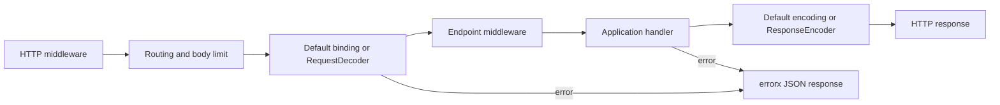

# transport/httpx

Module version for this revision: **v1.2.0**.

Use Go 1.27.3 and published servex v1.7.0.
The core includes the route request-decoder contract. From the contrib root:

```sh
task check lint vulncheck MODULES=transport/httpx
```

Dependencies resolve from published modules; no local core checkout is required. See [CONTRIBUTING](../../CONTRIBUTING.md#checks) for release validation.

The implementation satisfies core `transport/http.Server`, `Router`,
`EndpointRouter` and `Client`. Applications can depend on these HTTP boundaries while keeping
concrete construction, request binding, routing and client policy here.

Service registration can use core `http.RouteFunc(router, pattern, handler,
options...)` with an `http.EndpointRouter`. Core `http.Call[Request, Response]`
returns `func(context.Context, *Request) (*Response, error)` using this client,
including its existing middleware, retry policies and remote error handling.
httpx does not duplicate these helpers: register routes with core
`Route`/`RouteFunc` and options, and call `Client.Endpoint(method, path, newReply)`
when an untyped Endpoint is needed. The examples below import core
`transport/http` as `servexhttp`.

Close is idempotent and rejects new requests/retries with non-retryable
FailedPrecondition/CLIENT_CLOSED. Exchanges already running obey their contexts.
An injected http.Client and its transport remain owned by the caller.

Browser components live in independent capability modules:
[auth/login](../../auth/login) composes identity verification with
[session](../../session), and [session/redis](../../session/redis) supplies shared storage.
Importing httpx does not install these components or add their dependencies;
applications explicitly mount their native HTTP middleware and handlers.

Implements core transport.Server and HTTP clients with net/http. Routing,
request binding, body limits, error mapping, health endpoints and native HTTP
middleware moved intact from core. JSON and random defaults are selected
explicitly by this contrib adapter; the shared core client selects neither.

## Request decoding and response encoding

Codecs convert Go values and bytes; httpx owns HTTP binding and response handling.
Request/response hooks stay in this package (`request.go` / `response.go`), with
their route-option contracts in core transport/http. No separate decode package
or middleware is needed.



```go
type GetUserRequest struct {
    ID     string
    Locale string
}

servexhttp.RouteFunc(server, "GET /users/{id}", getUser,
    servexhttp.WithRequestDecoder(func(r *http.Request, dst any) error {
        req := dst.(*GetUserRequest)
        req.ID = r.PathValue("id")
        req.Locale = r.Header.Get("Accept-Language")
        return nil
    }),
    servexhttp.WithResponseEncoder(encodeUser),
)
```

The application supplies getUser and encodeUser. WithRequestDecoder fully
replaces Body/Query/Path/Form binding; no default binding runs afterward. Nil
restores the existing Body, then Query, then Path precedence. The target is
fresh per request, or nil for a nil factory. The request context contains HTTP
transport metadata. Decoding precedes endpoint middleware; response encoding
follows it, so whole-request observation/recovery belongs in HTTP middleware.

The decoder reads the size-limited Body without replacing it and honors request
cancellation. Remaining bytes are checked before invoking the endpoint. Files
parsed with ParseMultipartForm remain available through response encoding and
are removed on route return, including decoder failure. Do not retain request
objects after returning.

Decoder failures bypass endpoint middleware and the success encoder. Wrapped
errorx errors and context cancellation/deadlines retain their classification;
body overflow returns 413/BODY_TOO_LARGE. Other errors return fixed
400/DECODE_REQUEST JSON without the original error text. Return an errorx error
to choose a public code/reason/message explicitly. Decode failures stay JSON
regardless of Accept. Custom response encoding retains its existing rules:
errors before commitment return 500/ENCODE_REPLY; errors after commitment are
logged without writing a second response.

## File configuration

`ServerConfig` is a data-only model for configuration decoding. Initialize it
with `DefaultServerConfig()` before applying file/environment values, then call
`Validate()` or `NewServerFromConfig(config, runtimeOptions...)`. The latter
validates before constructing HTTP middleware and never opens a listener;
`Start` still owns listening.

```go
cfg := httpx.DefaultServerConfig()
if err := settings.Unmarshal("http", &cfg); err != nil { return err }
server, err := httpx.NewServerFromConfig(cfg,
    httpx.WithLogger(log),
    httpx.WithMiddleware(authenticate),
)
if err != nil { return err }
```

Here `settings` is a core config.Reader supplied by the application. Viper's
duration decoder accepts values such as `"5s"` from TOML/YAML. For example:

```toml
[http]
name = "http"
address = ":8000"
read_header_timeout = "5s"
idle_timeout = "60s"
max_header_bytes = 1048576
max_body_bytes = 4194304
```

Defaults match the existing `NewServer`: name `http`, address `:8000`, a 4 MiB
endpoint body limit, and zero timeouts. Set production timeouts explicitly.
Zero `max_body_bytes` disables the endpoint body limit; zero `max_header_bytes`
uses net/http's default. Zero timeouts retain net/http's documented fallback
semantics. Negative timeouts or limits, blank names and malformed/nonnumeric
host:port addresses are rejected. Port zero is valid for ephemeral listeners.

Middleware, Logger, codecs, health checks and protocol objects remain runtime
options. Options can override scalar configuration, but the effective settings
are validated again before construction. The low-level `NewServer(options...)`
entry remains available and retains its original behavior. Loading files,
configuration reload and resource replacement belong to the application.


## Validation

Run repository `task check MODULES='transport/httpx'`, `task lint` and
`task vulncheck` against published dependencies. Source overrides are an explicit development mode;
see the root CONTRIBUTING guide.
Original unit, race and composition regressions moved with the backend.
These tests do not require a shared or production service.

## Restricted outbound HTTP

`NewRestrictedHTTPClient(HTTPPolicy{})` supplies a bounded client for untrusted
URLs, independently of typed Client/Server APIs. Defaults: 30-second timeout,
16 MiB decompressed response body, no environment proxy/retry/cookie jar. It
accepts HTTP(S) URLs without credentials, rejects private/reserved IPs including
IPv4-mapped addresses and translation/tunnel ranges, checks every DNS answer,
and dials only checked IPs while retaining the TLS hostname. Redirects repeat
validation, reject HTTPS downgrade and stop at ten hops. CloseIdleConnections
releases owned transport connections. `ErrResponseTooLarge` detects both known
Content-Length and streaming overflow. `AllowPrivateNetwork` is explicit for
trusted internal endpoints; all other limits still apply.

This shared foundation is used by AgentX web readers/connectors; core AgentX
does not depend on Servex. Applications using a custom client own its network
and proxy policy.

受限出站 HTTP 客户端支持 DNS 地址固定、重定向检查、私网/保留地址拒绝和响应上限；
默认不继承环境代理，不增加自动重试。可信内部服务可显式允许私网访问。

## Explicit HTTP middleware

Pass individual Endpoint middleware directly to `WithMiddleware` for registered
Endpoint routes. Native HTTP handlers, unmatched requests, preflight, CORS, CSRF
and Session operate outside that route boundary. To observe the whole request,
wrap the explicitly selected middleware through `EndpointFilter`:

```go
import (
    endpointmw "github.com/nostosx/servex-contrib/middleware/endpoint"
    "github.com/nostosx/servex-contrib/transport/httpx"
)

server := httpx.NewServer(httpx.WithHTTPMiddleware(
    httpx.EndpointFilter("http.request",
        endpointmw.Tracing(tracer, propagator),
        endpointmw.Logging(log),
        endpointmw.Metrics(meter),
        endpointmw.Recovery(endpointmw.WithRecoveryLogger(log)),
    ),
))
```

This is an assembly fragment using application-owned signal backends.
Use the middleware/endpoint package for WithMiddleware and EndpointFilter.
Outbound WithClientMiddleware uses middleware/client; WithClientAttemptMiddleware
uses its AttemptLogging, AttemptMetrics and AttemptTracing factories. Business
policies use middleware/application and application.Decorate independently of HTTP.
`EndpointFilter` adapts only the supplied middleware, in written order. It adds no
observations, recovery or replay on its own. Use a stable bounded operation name.
Choose request-level or route-level observation unless both scopes are intended.
Response-controller access, flushing and hijacking remain available to SSE and
WebSocket handlers. The application also selects the order of native Session,
CSRF and CORS wrappers through `WithHTTPMiddleware`.

## Server logging

Server diagnostics honor Logger.Enabled and record errorx code, non-empty reason,
retryable and remote without raw error messages, metadata or causes. Both current
trace/span IDs are included when present on the request context. Endpoint child
contexts remain local to middleware; its completion log carries child-span IDs.
net/http diagnostic strings become a fixed HTTP_SERVER_DIAGNOSTIC event instead
of forwarding request data or panic stacks. Error response Message/Metadata and
retry ownership are unchanged; applications own localization independently.
